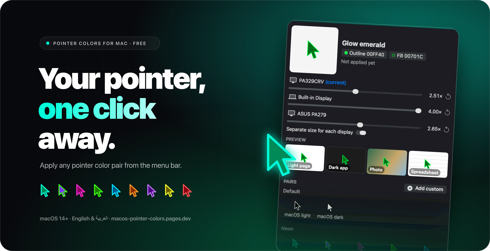
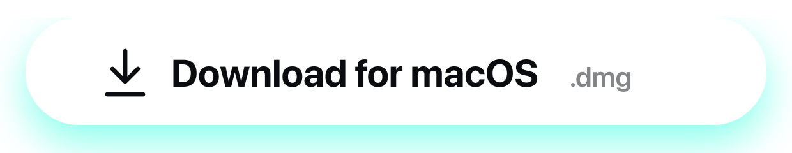
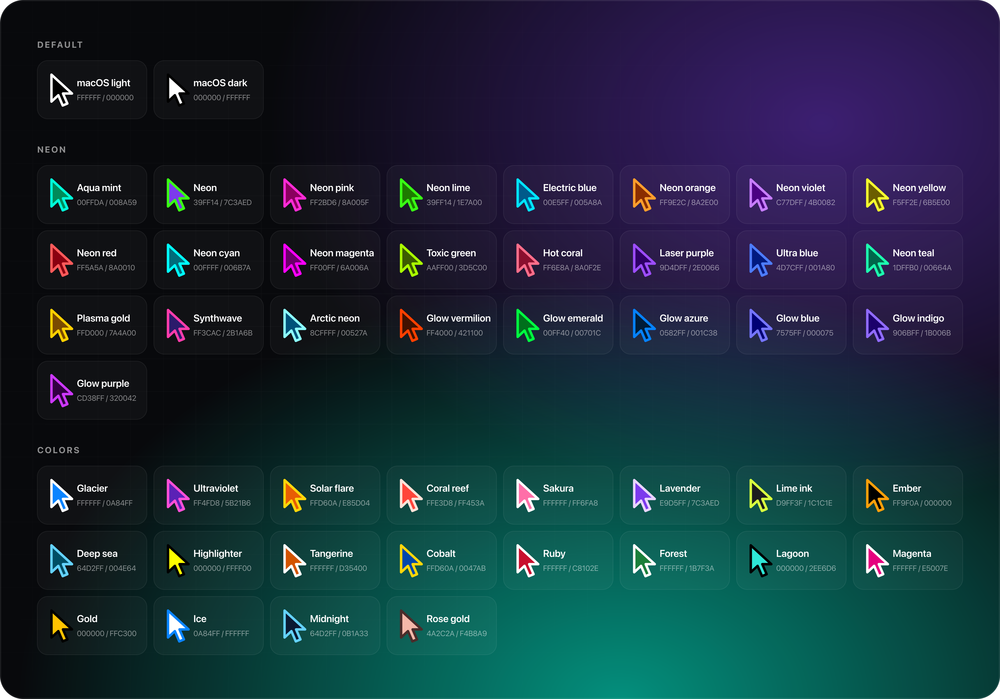
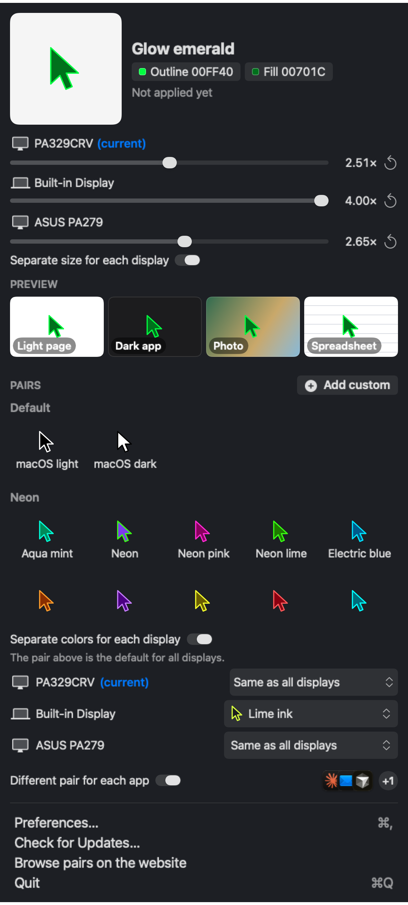

<p align="center">
  <a href="https://macos-pointer-colors.pages.dev"></a>
</p>

<p align="center">
  <a href="https://github.com/mustafaabobakr/macos-pointer-colors/releases/latest"></a>
  <a href="https://github.com/mustafaabobakr/macos-pointer-colors/releases"></a>
  <a href="https://github.com/mustafaabobakr/macos-pointer-colors/stargazers"></a>
  
  <a href="https://macos-pointer-colors.pages.dev"></a>
</p>

<p align="center">
  <a href="https://github.com/mustafaabobakr/macos-pointer-colors/releases/latest/download/Pointer-Colors.dmg"></a>
</p>

<p align="center">
  <a href="https://macos-pointer-colors.pages.dev"><b>Try the pairs live</b></a> ·
  <a href="https://macos-pointer-colors.pages.dev/?outline=00FFDA&fill=008A59&name=Aqua%20mint"><b>Open a shared pair</b></a> ·
  <a href="https://macos-pointer-colors.pages.dev/?lang=ar"><b>العربية</b></a> ·
  <a href="#build-it-yourself"><b>Build it</b></a>
</p>

<br>

**Change the mouse pointer color and size on your Mac.** macOS lets you recolor the cursor, but only through two hex fields buried in System Settings. **Pointer Colors** gives you 47 outline and fill color pairs to try on a live preview, and a free menu-bar app that applies one in a single click. It works on macOS Sonoma, Sequoia and Tahoe, and helps with low vision, big screens, presentations and screen recordings.

## Two ways to use it

<table>
  <tr>
    <td width="50%" valign="top">
      <h3>The website</h3>
      <p><a href="https://macos-pointer-colors.pages.dev">macos-pointer-colors.pages.dev</a></p>
      <ul>
        <li><b>Live preview</b> on a macOS-style desktop with Colorful, Light, Dark and Busy wallpapers, and a size slider</li>
        <li><b>Visibility check</b> on a light page, a dark app, a photo and a spreadsheet</li>
        <li><b>Mix your own</b> with the color pickers</li>
        <li><b>Share a pair</b>: one link opens the page with your colors selected</li>
        <li><b>Add to Mac app</b>: sends the pair straight to the app</li>
        <li><b>English and Arabic</b>, right to left included</li>
      </ul>
    </td>
    <td width="50%" valign="top">
      <h3>The Mac app</h3>
      <p><a href="https://github.com/mustafaabobakr/macos-pointer-colors/releases/latest">Latest release</a> · menu bar · free</p>
      <ul>
        <li><b>One click</b> applies a pair, no hex codes</li>
        <li><b>Per display</b>: a different color and size on each screen</li>
        <li><b>Per app</b>: a pair that follows the app in front</li>
        <li><b>Light and dark</b>: switches pairs with the system appearance</li>
        <li><b>Shortcuts</b>, contrast warnings, shake to find</li>
        <li><b>Your own pairs</b>, import and export</li>
      </ul>
    </td>
  </tr>
</table>

## Every pair, one file

<p align="center"></p>

The macOS defaults for light and dark come first, then the neon and color pairs. All of them live in [`pairs.json`](pairs.json), the one list both the website and the app read. Add a pair there and it shows up in both.

## The Mac app

<table>
  <tr>
    <td valign="top">
      <h3>Install</h3>
      <ol>
        <li><a href="https://github.com/mustafaabobakr/macos-pointer-colors/releases/latest/download/Pointer-Colors.dmg">Download <code>Pointer-Colors.dmg</code></a> and drag <b>Pointer Colors</b> into Applications.</li>
        <li>The app is <ins><b>not notarized yet</b></ins>, so the first time, <b>right-click it and choose Open</b>, allow it in <b>System Settings › Privacy &amp; Security</b>, or run this in Terminal:
<pre><code>xattr -cr "/Applications/Pointer Colors.app"</code></pre></li>
        <li>Click the pointer in the menu bar and pick a pair.</li>
      </ol>
      <h3>Good to know</h3>
      <ul>
        <li>macOS 14 or later.</li>
        <li>If a color or size doesn't change, turn on Pointer Colors under <b>System Settings › Privacy &amp; Security › Full Disk Access</b>. The app says when it needs this.</li>
        <li>It changes the same settings as <b>System Settings › Accessibility › Display › Pointer</b>, through private macOS APIs. That's why it isn't on the Mac App Store.</li>
      </ul>
    </td>
    <td width="300" valign="top">
      
    </td>
  </tr>
</table>

## Prefer System Settings?

Copy the two codes from the website, then:

1. Open **System Settings › Accessibility › Display** and scroll to **Pointer**.
2. Click **Pointer outline color**, choose the sliders tab, set it to **Hex Color**, and paste the outline code.
3. Do the same for **Pointer fill color**.
4. Drag **Pointer size** if you want it bigger. **Reset** brings back black and white.

## FAQ

**How do I change the mouse pointer color on a Mac?**<br>
Open **System Settings › Accessibility › Display**, scroll to **Pointer**, and set **Pointer outline color** and **Pointer fill color** with hex codes from [the website](https://macos-pointer-colors.pages.dev). Or use the Pointer Colors app to apply a pair in one click.

**How do I make the cursor bigger on macOS?**<br>
Drag **Pointer size** on the same settings screen, or use the size slider in the app, which can also set a different size on each display.

**How do I reset the pointer to black and white?**<br>
Click **Reset Colors** under Pointer in System Settings, or pick the **macOS light** or **macOS dark** pair.

**Which pointer colors are easiest to see?**<br>
A pair where the outline or the fill stands out on both white pages and dark apps. The website shows each pair on four backgrounds, and the app warns when a pair is hard to see.

**macOS says the app can't be opened or verified. What do I do?**<br>
It's not notarized yet. Right-click it and choose **Open**, allow it in **System Settings › Privacy & Security**, or run `xattr -cr "/Applications/Pointer Colors.app"` in Terminal.

**Is it free?**<br>
Yes. The website and the app are free and open source.

## Build it yourself

**Website.** Static, no build step. It loads `pairs.json`, so serve the folder:

```sh
python3 -m http.server 8000   # then open http://localhost:8000
```

**Mac app.** Needs Xcode 26 or later (for the Liquid Glass icon):

```sh
mac/scripts/build-app.sh            # builds mac/build/Pointer Colors.app
mac/scripts/make-dmg.sh             # builds mac/build/Pointer-Colors.dmg
cd mac && swift test                # unit tests
```

**README art.** The images above are drawn from `pairs.json` and the app screenshot:

```sh
python3 -I docs/art/make_readme_art.py   # needs: brew install librsvg
```

| Path | What's there |
| --- | --- |
| [`index.html`](index.html) | The website, one file |
| [`pairs.json`](pairs.json) | Every pair, shared by the site and the app |
| [`mac/`](mac) | The SwiftUI menu-bar app, tests and build scripts |
| [`docs/`](docs) | Screenshots, README art and the social preview |
The site deploys to Cloudflare Pages from `main`: no framework preset, no build command, output directory `/`.

<br>

<p align="center">
  Created by <a href="https://github.com/mustafaabobakr">Mostafa Abobakr</a> · If it helps, a <a href="https://github.com/mustafaabobakr/macos-pointer-colors">star on GitHub</a> is appreciated
</p>
