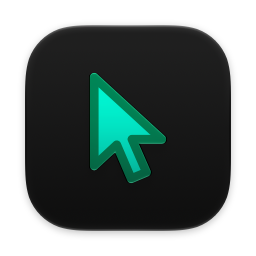
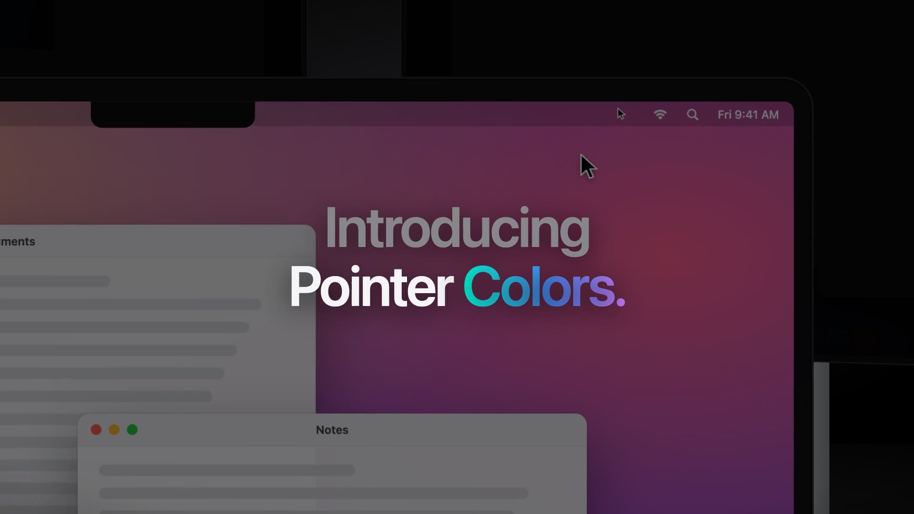

<p align="center">
  
</p>

<p align="center">
  <a href="https://github.com/mustafaabobakr/macos-pointer-colors/releases/latest"></a>
  <a href="https://github.com/mustafaabobakr/macos-pointer-colors/releases"></a>
  <a href="https://github.com/mustafaabobakr/macos-pointer-colors/stargazers"></a>
  <a href="LICENSE"></a>
  
  <a href="https://macos-pointer-colors.pages.dev"></a>
</p>

<p align="center">
  <a href="https://github.com/mustafaabobakr/macos-pointer-colors/releases/latest/download/Pointer-Colors.dmg"></a>
</p>

<p align="center">
  <a href="https://macos-pointer-colors.pages.dev"><b>Try the pairs live</b></a> ·
  <a href="https://macos-pointer-colors.pages.dev/?outline=00FFDA&fill=008A59&name=Aqua%20mint"><b>Open a shared pair</b></a> ·
  <a href="https://macos-pointer-colors.pages.dev/?lang=ar"><b>العربية</b></a> ·
  <a href="#build-it-yourself"><b>Build it</b></a>
</p>

<p align="center">
  <a href="https://macos-pointer-colors.pages.dev"></a>
</p>

<br>

<p align="center">
  <a href="https://macos-pointer-colors.pages.dev/docs/promo/pointer-colors-promo.mp4"></a>
  <br><sub><a href="https://macos-pointer-colors.pages.dev/docs/promo/pointer-colors-promo.mp4"><b>▶ Watch the 30-second film</b></a></sub>
</p>

**Change the mouse pointer color and size on your Mac.** macOS lets you recolor the cursor, but only through two hex fields buried in System Settings. **Pointer Colors** gives you 47 outline and fill color pairs to try on a live preview, and a free menu-bar app that applies one in a single click. The app also highlights your clicks for screen recordings, draws with a laser pointer, sets or turns off mouse acceleration, makes the mouse's side buttons go back and forward in Safari and Finder, stops accidental double-clicks, focuses the window under the pointer, and finds a lost cursor with a double press of Control. It works on macOS Sonoma, Sequoia and Tahoe, and helps with low vision, big screens, presentations and screen recordings.

## Two ways to use it

<table>
  <tr>
    <td width="50%" valign="top">
      <h3>The website</h3>
      <p><a href="https://macos-pointer-colors.pages.dev">macos-pointer-colors.pages.dev</a></p>
      <ul>
        <li><b>Live preview</b> on a macOS-style desktop with Colorful, Light, Dark and Busy wallpapers, and a size slider</li>
        <li><b>Visibility check</b> on a light page, a dark app, a photo and a spreadsheet</li>
        <li><b>Mix your own</b> with the color pickers</li>
        <li><b>Share a pair</b>: one link opens the page with your colors selected</li>
        <li><b>Add to Mac app</b>: sends the pair straight to the app</li>
        <li><b>English and Arabic</b>, right to left included</li>
      </ul>
    </td>
    <td width="50%" valign="top">
      <h3>The Mac app</h3>
      <p><a href="https://github.com/mustafaabobakr/macos-pointer-colors/releases/latest">Latest release</a> · menu bar · free</p>
      <ul>
        <li><b>One click</b> applies a pair, no hex codes</li>
        <li><b>Per display</b>: a different color and size on each screen</li>
        <li><b>Per app</b>: a pair that follows the app under the pointer, or the app in front</li>
        <li><b>Light and dark</b>: switches pairs with the system appearance</li>
        <li><b>Click highlight</b>: pulses, a laser pointer and a ring</li>
        <li><b>Mouse acceleration and speed</b>, or acceleration off</li>
        <li><b>Side buttons</b> back and forward, <b>double-click fix</b></li>
        <li><b>Find the pointer</b>: press Control twice</li>
        <li><b>Shortcuts</b>, contrast warnings, your own pairs</li>
      </ul>
    </td>
  </tr>
</table>

## Every feature of the Mac app

Every feature has its own setting in Preferences, so you turn on only what you need.

**Pointer color and size**
- **Every pair, one click away**: pick one of 47 pairs in the menu bar and the pointer changes right away.
- **Any pointer size**: drag to make the cursor bigger, or give each display its own size.
- **Preview before you pick**: see the pointer on light pages, dark apps, photos and spreadsheets.
- **Contrast warnings**: the menu tells you when a pair is hard to see, and copies its hex codes.
- **Make your own pairs**: add, edit, hide, import and export custom outline and fill colors.

**Automatic pairs**
- **A pair for each display**: colors switch as the pointer crosses to another screen.
- **A pair for each app**: each app gets its own pair while the pointer is over it, or while it's in front.
- **Follows light and dark**: one pair for light appearance, another for dark, switched for you.

**Highlight clicks for presentations and screen recordings**
- **Click pulses**: a ring or ripple on every click, with its own size, length and color.
- **Laser pointer**: drag to draw a glowing trail that fades, or draw only while holding keys you choose.
- **Ring around the pointer**: keeps the cursor easy to follow on a shared screen.
- **Press to shrink**: the pointer shrinks while the button is down, so every click shows on the cursor itself.
- **Highlight colors per pair**: a pulse and laser color for any pair.

**Mouse speed and acceleration**
- **Disable pointer acceleration**: the pointer moves the same distance however fast you move the mouse, with its own tracking speed.
- **Pointer acceleration** from 0 to 40, and **pointer speed** from 0 to 1, past what System Settings › Mouse allows.
- Kept on every mouse as it connects and after sleep; trackpads keep their own settings. A reset button next to each one puts the macOS default back.

**Mouse buttons**
- **Back and forward in every app**: the mouse's side buttons go back and forward in Safari, Finder, Music and Apple's other apps, not just in browsers.
- **Fix accidental double-clicks**: a worn button that clicks twice clicks once; you choose how close together clicks are ignored.

**Find the pointer**
- **Press Control twice** and a ring in your pair's colors closes in on the cursor. Pick Option, Shift or Command instead.
- **Shake to find**: turn macOS's shake-to-locate on or off.

**Windows**
- **Focus the window under the pointer**: type into any window just by pointing at it, without bringing it to the front. Hold a modifier key to pass over windows.

**Menu bar and Dock**
- **Mouse battery** next to the menu-bar icon, always or only when it's low.
- **Hide the menu-bar icon** or **show the app in the Dock**.
- **Keyboard shortcuts** from any app to switch pairs and resize the pointer.
- **Make the menu yours**: theme, glass, tint and text size.

**Settings and updates**
- **Back up every setting** to one file and import it on another Mac.
- **Updates in one click**: read what's new, then install on quit or right away.

## Every pair, one file

<p align="center"></p>

The macOS defaults for light and dark come first, then the neon and color pairs. All of them live in [`pairs.json`](pairs.json), the one list both the website and the app read. Add a pair there and it shows up in both.

## The Mac app

<table>
  <tr>
    <td valign="top">
      <h3>Install</h3>
      <ol>
        <li><a href="https://github.com/mustafaabobakr/macos-pointer-colors/releases/latest/download/Pointer-Colors.dmg">Download <code>Pointer-Colors.dmg</code></a> and drag <b>Pointer Colors</b> into Applications.</li>
        <li>The app is <ins><b>not notarized yet</b></ins>, so the first time, <b>right-click it and choose Open</b>, then click <b>Open Anyway</b> in <b>System Settings › Privacy &amp; Security</b>. Or run this in Terminal, then open it as usual:
<pre><code>xattr -cr "/Applications/Pointer Colors.app"</code></pre></li>
        <li>Click the pointer in the menu bar and pick a pair.</li>
      </ol>
      <h3>Good to know</h3>
      <ul>
        <li>macOS 14 or later, on Apple silicon or Intel.</li>
        <li>If a color or size doesn't change, turn on Pointer Colors under <b>System Settings › Privacy &amp; Security › Full Disk Access</b>. The app says when it needs this.</li>
        <li>It changes the same settings as <b>System Settings › Accessibility › Display › Pointer</b>, through private macOS APIs. That's why it isn't on the Mac App Store.</li>
      </ul>
    </td>
    <td width="300" valign="top">
      
    </td>
  </tr>
</table>

## Prefer System Settings?

Copy the two codes from the website, then:

1. Open **System Settings › Accessibility › Display** and scroll to **Pointer**.
2. Click **Pointer outline color**, choose the sliders tab, set it to **Hex Color**, and paste the outline code.
3. Do the same for **Pointer fill color**.
4. Drag **Pointer size** if you want it bigger. **Reset** brings back black and white.

## FAQ

**How do I change the mouse pointer color on a Mac?**<br>
Open **System Settings › Accessibility › Display**, scroll to **Pointer**, and set **Pointer outline color** and **Pointer fill color** with hex codes from [the website](https://macos-pointer-colors.pages.dev). Or use the Pointer Colors app to apply a pair in one click.

**How do I make the cursor bigger on macOS?**<br>
Drag **Pointer size** on the same settings screen, or use the size slider in the app, which can also set a different size on each display.

**How do I reset the pointer to black and white?**<br>
Click **Reset Colors** under Pointer in System Settings, or pick the **macOS light** or **macOS dark** pair.

**Which pointer colors are easiest to see?**<br>
A pair where the outline or the fill stands out on both white pages and dark apps. The website shows each pair on four backgrounds, and the app warns when a pair is hard to see.

**macOS says the app can't be opened or verified. What do I do?**<br>
It's not notarized yet. Right-click it and choose **Open**, then click **Open Anyway** in **System Settings › Privacy & Security**. Or run `xattr -cr "/Applications/Pointer Colors.app"` in Terminal, then open it as usual.

**Why does the app ask for Full Disk Access?**<br>
macOS keeps the pointer color and size settings in a protected Accessibility preferences file (`com.apple.universalaccess`). Apps from outside the App Store can only change that file with Full Disk Access. Pointer Colors first tries Apple's own `defaults` tool, which usually works without it, and only asks when macOS blocks both. It only touches the pointer color, size and shake-to-find settings, reads no other files, and sends nothing anywhere.

**How do I change mouse acceleration or turn it off on a Mac?**<br>
Open **Preferences › Speed** in the app and turn on **Disable pointer acceleration** for a linear mouse, or drag **Pointer acceleration** up to 40 to make fast movements go further. **Pointer speed** sets how far the pointer moves. Some mice, like Apple's Magic Mouse, keep their own speed on recent macOS; acceleration still works on them.

**How do I highlight mouse clicks for a screen recording or presentation?**<br>
Turn on **Pulse** in **Preferences › Highlight** for a ring on every click, or **Laser** to draw a fading trail while you drag. Both use your pair's colors and show up in screen recordings and when you share your screen.

**Why doesn't my mouse's back button work in Safari or Finder?**<br>
macOS only passes side buttons to apps that read them, like Chrome. Turn on **Back and forward in every app** in **Preferences › Buttons**, and the buttons go back and forward in Safari, Finder and Apple's other apps too.

**How do I stop my mouse from double-clicking on its own?**<br>
A worn switch can send two clicks for one press. Turn on **Fix accidental double-clicks** in **Preferences › Buttons**: a click that comes within a few milliseconds of the last one is ignored.

**Can a Mac focus the window under the mouse, like Linux?**<br>
Yes. Turn on **Focus the window under the pointer** in **Preferences › Automation**. The window takes your typing without coming to the front.

**Why does the app ask for Accessibility?**<br>
Side buttons, the double-click fix and focus-follows-pointer have to see clicks before apps do, which macOS only allows with Accessibility. The app asks only when you turn one of them on.

**How do I find a lost cursor on a big screen?**<br>
Turn on **Show pointer location** in **Preferences › Automation** and press **Control** twice: a ring closes in on the pointer. Shake to find, a bigger pointer and a high-contrast pair help too.

**Is it free?**<br>
Yes. The website and the app are free and open source under the [MIT License](LICENSE). To report a security issue, see [SECURITY.md](SECURITY.md).

## Build it yourself

**Website.** Static, no build step. It loads `pairs.json`, so serve the folder:

```sh
python3 -m http.server 8000   # then open http://localhost:8000
```

**Mac app.** Needs Xcode 26 or later (for the Liquid Glass icon):

```sh
mac/scripts/build-app.sh            # builds mac/build/Pointer Colors.app
mac/scripts/make-dmg.sh             # builds mac/build/Pointer-Colors.dmg
cd mac && swift test                # unit tests
```

Release builds must be signed with the **Pointer Colors Dev** certificate, or installed copies refuse them as updates. `mac/scripts/export-signing-identity.sh` saves it from the keychain to `mac/signing/`, which git ignores; the build puts it back into the keychain when it's missing there, and stops if a release would be signed with anything else.

**README art.** The images above are drawn from `pairs.json` and the app screenshot:

```sh
python3 -I docs/art/make_readme_art.py   # needs: brew install librsvg
```

| Path | What's there |
| --- | --- |
| [`index.html`](index.html) | The website, one file |
| [`pairs.json`](pairs.json) | Every pair, shared by the site and the app |
| [`mac/`](mac) | The SwiftUI menu-bar app, tests and build scripts |
| [`docs/`](docs) | Screenshots, README art and the social preview |
The site deploys to Cloudflare Pages from `main`: no framework preset, no build command, output directory `/`.

<br>

Mouse speed and acceleration, side buttons, the double-click fix and focus-follows-pointer work the way [LinearMouse](https://github.com/linearmouse/linearmouse) (MIT) does them, and window focusing comes from [yabai](https://github.com/asmvik/yabai) (MIT) through it. The double press to find the pointer follows LinearMouse's idea.

<p align="center">
  Created by <a href="https://github.com/mustafaabobakr">Mostafa Abobakr</a> · If it helps, a <a href="https://github.com/mustafaabobakr/macos-pointer-colors">star on GitHub</a> is appreciated
</p>
