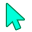
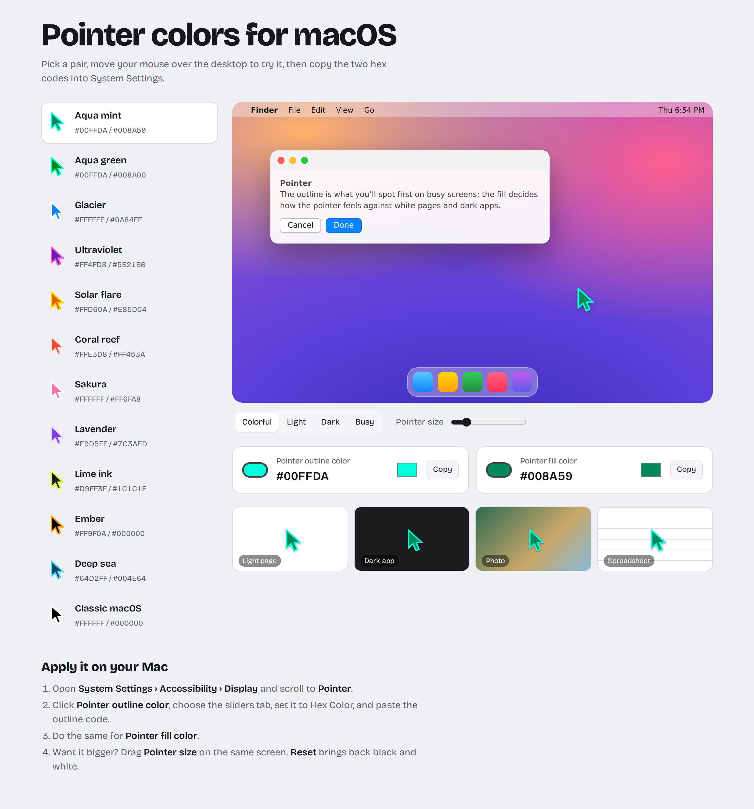

<p align="center"></p>

<h1 align="center">Pointer colors for macOS</h1>

A small gallery of pointer outline and fill color pairs for macOS, with a live preview. Pick a pair, move your mouse over the fake desktop to try it, then copy the two hex codes into System Settings.



## Features

- The macOS light and dark defaults plus 22 hand-picked outline/fill pairs, and color pickers to mix your own
- Live pointer preview on a macOS-style desktop with Colorful, Light, Dark and Busy wallpapers
- Pointer size slider
- Visibility tiles: light page, dark app, photo and spreadsheet
- One-click copy of each hex code (without the `#`, ready for the macOS Hex field)

## Apply a pair on your Mac

1. Open **System Settings › Accessibility › Display** and scroll to **Pointer**.
2. Click **Pointer outline color**, choose the sliders tab, set it to **Hex Color**, and paste the outline code.
3. Do the same for **Pointer fill color**.
4. Use **Reset** to go back to black and white.

## Mac app (work in progress)

`mac/` holds a native SwiftUI menu-bar app that applies pairs directly.

- Pick a pair and apply it, or add your own with color pickers
- Pointer size slider with a reset button
- Visibility previews on a light page, dark app, photo and spreadsheet
- Contrast warning when a pair is hard to see on light or dark screens
- Global keyboard shortcuts (none assigned until you record one)
- Automation: one pair for light appearance and one for dark, a pointer size per display, and the "Shake mouse pointer to locate" toggle
- "Add to Pointer Colors for Mac" on the website opens the app through `pointercolors://add` links
- Text size setting for the app itself (Automatic uses Large on big screens)
- Optional update check against GitHub Releases (off by default)
- English and Arabic

Building needs Xcode 26 or later (for the Liquid Glass icon):

```sh
mac/scripts/build-app.sh
open "mac/build/Pointer Colors.app"
```

- **Needs Full Disk Access.** Pointer colors and size live in `com.apple.universalaccess`, which macOS only lets third-party apps write with Full Disk Access. The app explains this and links to the setting.
- **Pointer size** changes live through `UACursorSetScale`, the private UniversalAccess call System Settings uses, and is saved to `mouseDriverCursorSize` so it sticks.
- It uses private API and isn't sandboxed, so it can't ship on the Mac App Store.

## Run locally

It's static with no build step. The page loads `pairs.json`, so serve the folder rather than opening the file directly:

```sh
python3 -m http.server 8000
```

Then open http://localhost:8000.

## Pointer pairs

`pairs.json` is the one list of pairs for both the website and the Mac app (the app bundles it at build time). Add or change a pair there and both pick it up. The first two entries are the macOS defaults for light and dark appearance.

## Deploy

Hosted on Cloudflare Pages straight from this repo: no framework preset, no build command, build output directory `/`.
